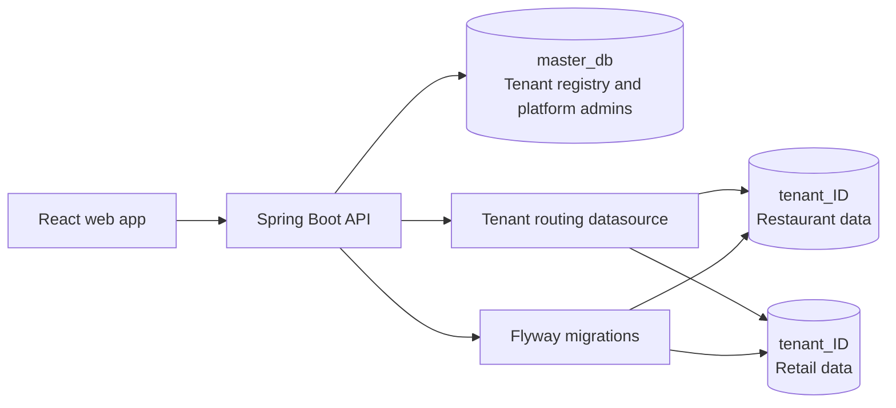

# MultiTenant SaaS Platform

A multi-tenant SaaS starter for restaurant and retail businesses. A shared platform database stores tenant registrations and platform administrators; each active tenant gets a separate MySQL database for its users and business data.

## Architecture



The API authenticates users with JWTs. For tenant requests, the JWT's tenant ID is installed in request context and selects the tenant datasource; tenant IDs are not taken from a client-supplied header. Platform administrator requests use the shared master database. The `X-Tenant-Id` header used by early development endpoints is not a substitute for authentication.

## Technology stack

- Backend: Java 17, Spring Boot 3.3, Spring Security, Spring Data JPA, Flyway, MySQL 8.
- Frontend: React 19, Vite, React Router, Axios, and Recharts.
- Tenant isolation: one MySQL database per tenant, dynamically routed using the authenticated JWT.

## Prerequisites

- JDK 17.
- Apache Maven 3.9 or newer.
- Node.js 22 LTS and npm.
- MySQL 8, reachable by the backend account. That account must be able to create tenant databases as businesses register.

## Local setup

### 1. Create the master database

Start MySQL, then from the repository root create the shared database and install its schema:

```powershell
mysql -u root -p -e "CREATE DATABASE IF NOT EXISTS master_db"
Get-Content .\backend\src\main\resources\db\master\master_schema.sql | mysql -u root -p master_db
```

The backend applies Flyway migrations to tenant databases when tenants are provisioned and again at startup for every active tenant. Do not manually create tenant databases.

### 2. Configure and run the backend

The backend reads configuration from environment variables; it does not automatically load `backend\.env.example`. In PowerShell, set the values in the same terminal used to start Maven:

```powershell
$env:MASTER_DB_URL = "jdbc:mysql://localhost:3306/master_db"
$env:MASTER_DB_USER = "root"
$env:MASTER_DB_PASSWORD = "<your-local-mysql-password>"
$env:JWT_SECRET = "<a-random-secret-of-at-least-32-bytes>"
$env:PLATFORM_ADMIN_EMAIL = "admin@example.com"
$env:PLATFORM_ADMIN_PASSWORD = "<a-local-development-password>"
Set-Location .\backend
mvn spring-boot:run
```

The API listens on `http://localhost:8081`. The platform administrator is seeded from `PLATFORM_ADMIN_EMAIL` and `PLATFORM_ADMIN_PASSWORD` on startup. Use development-only values locally; configure strong secrets outside development.

### 3. Configure and run the frontend

In another terminal, from the repository root:

```powershell
Copy-Item .\frontend\.env.example .\frontend\.env.local
Set-Location .\frontend
npm install
npm run dev
```

Vite prints the local web URL, usually `http://localhost:5173`. The example frontend environment points its API client at `http://localhost:8081/api`.

To check the project:

```powershell
Set-Location .\backend
mvn test
Set-Location ..\frontend
npm run lint
npm run build
```

## Tenant provisioning, authentication, and routing

1. A business registers with its business name, business code, business type (`RESTAURANT` or `RETAIL`), and owner details.
2. The platform stores the tenant record in `master_db`, creates a database named `tenant_<id>`, and applies the shared core plus business-specific Flyway migrations.
3. The owner signs in with the business code and their account credentials. The API returns a JWT containing the tenant identity and role.
4. The request filter validates the token, resolves the active tenant's datasource, and routes tenant repositories to that database for the duration of the request.
5. Platform administrators authenticate separately and can manage tenant status. Only active tenants are registered for tenant-data access.

Tenant database names are derived from the tenant ID rather than accepted from a registration request. On application restart, the migration runner applies pending migrations separately for each active tenant; a migration failure is logged and does not prevent other tenants from starting.

## Adding a business domain

1. Add versioned SQL migrations under `backend/src/main/resources/db/<domain>/` (for example, `V100__domain_tables.sql`). Put shared tenant tables in `db/core/`.
2. Add the domain business type to `BusinessType`.
3. Implement tenant-scoped entities, repositories, DTOs, services, controllers, authorization, and validation in a domain package under `com.saas.platform`.
4. Add the domain package to tenant entity scanning and repository scanning in `TenantDataSourceConfig`.
5. Ensure provisioning selects the matching migration folder and domain. Update the frontend navigation and pages to show only for matching tenant types and authorized roles.
6. Add tests for migration, tenant isolation, authorization, validation, and business workflows.

Never expose persistence entities directly from API endpoints; map them to response DTOs. Never trust a tenant identifier supplied by the browser to select a database.

## Demo script

1. Start MySQL, the backend, and the frontend using the local setup above.
2. Register a restaurant and a retail shop from the app, using distinct business codes and owner accounts. Confirm both registrations succeed.
3. Sign in to each business in separate browser sessions. Add a restaurant menu item/order and retail products/stock/sales using the relevant pages.
4. Sign out, then sign in to the other business. Confirm its dashboard and lists show only its own records; matching numeric record IDs do not cross database boundaries.
5. Sign in as the platform administrator to view and manage tenant registrations. Suspending a tenant prevents its tenant token from accessing business data.

For API-based checks, authenticate through the login UI/API and use the returned bearer token. Retail endpoints return `403 Forbidden` for restaurant tenants, and vice versa.

## Project layout

```text
backend/
  src/main/java/com/saas/platform/       API, security, tenancy, restaurant and retail modules
  src/main/resources/db/                 Master and tenant Flyway migrations
  src/test/java/                         Unit and migration tests
frontend/
  src/                                    React application
AGENT_PLAN.md                             Development roadmap
```
